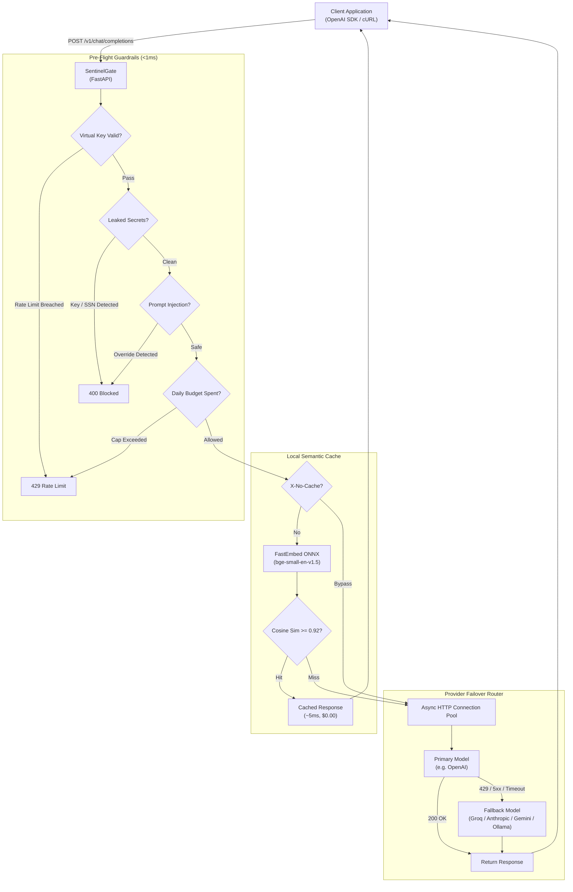

# SentinelGate

A lightweight, OpenAI-compatible LLM gateway with local semantic caching, pre-flight secret guardrails, and automatic provider failover—backed only by SQLite.

[](https://www.python.org/)
[](https://fastapi.tiangolo.com/)
[](https://www.sqlite.org/)
[](LICENSE)

---

## Why I Built This

I wanted a self-hosted LLM gateway that could cache repetitive queries, prevent accidental API key leaks, and switch to fallback models when upstream providers hit rate limits.

Most existing open-source gateways pull in heavy dependency trees: Docker Compose setups with Redis clusters, PostgreSQL databases, Celery workers, and Prisma runtimes just to proxy a few HTTP calls.

SentinelGate keeps things simple. It runs as a single FastAPI process using SQLite in WAL mode for storage and `fastembed` for in-process semantic embeddings. There are no external databases, message brokers, or node build steps required.

---

## Architecture



---

## Measured Benchmarks

Measured on an Apple Silicon host running Python 3.9 using `benchmarks/bench.py` over 100 requests (repeating semantic clusters with mocked upstream latency):

| Metric | Measured Result |
|---|---|
| **Pure Gateway Overhead (Min)** | **3.13 ms** |
| **Semantic Cache Hit Latency (Avg)** | **5.22 ms** |
| **Cache Miss Latency (Upstream + Proxy)** | 28.50 ms |
| **Cache Hit Rate** | **91.0%** (91/100) |
| **Latency P50** | 4.33 ms |
| **Latency P95** | 23.27 ms |
| **Latency P99** | 34.83 ms |
| **Idle RAM (Base Process)** | 236.5 MB |
| **Active RAM (Loaded ONNX Runtime)** | **451.9 MB** |

To reproduce these numbers locally:
```bash
uv run python benchmarks/bench.py
```

---

## Quickstart (Under 60 Seconds)

### 1. Clone and Install

```bash
git clone https://github.com/giridhar2005/sentinelgate.git
cd sentinelgate

# Using uv (recommended)
uv sync

# Or using pip
pip install -e .
```

### 2. Configure Environment

Copy the example configuration file and set your API keys:

```bash
cp config.example.yaml config.yaml
cp .env.example .env

# Set at least one provider key in .env or your shell
export OPENAI_API_KEY="sk-..."
export GROQ_API_KEY="gsk_..."
```

### 3. Run the Server

```bash
uv run uvicorn main:app --host 0.0.0.0 --port 8000
```

The gateway is now listening on `http://localhost:8000`.

- Health check: `http://localhost:8000/health`
- Embedded HUD: `http://localhost:8000/dashboard`
- OpenAI proxy: `http://localhost:8000/v1/chat/completions`

### 4. Query with the OpenAI Python SDK

SentinelGate works as a drop-in replacement for OpenAI endpoints:

```python
from openai import OpenAI

client = OpenAI(
    base_url="http://localhost:8000/v1",
    api_key="sg-local-test",  # Any string or virtual key
)

response = client.chat.completions.create(
    model="gpt-4o-mini",
    messages=[
        {"role": "user", "content": "Explain connection pooling in one sentence."},
    ],
)

print(response.choices[0].message.content)
```

For streaming responses, set `stream=True`:

```python
stream = client.chat.completions.create(
    model="gpt-4o-mini",
    messages=[{"role": "user", "content": "List 3 advantages of SQLite."}],
    stream=True,
)

for chunk in stream:
    if chunk.choices[0].delta.content:
        print(chunk.choices[0].delta.content, end="", flush=True)
print()
```

---

## Core Features

- **Local Semantic Caching:** Uses `fastembed` (`BAAI/bge-small-en-v1.5`) in-process to compute embeddings without calling external vector APIs. Embeddings and responses are stored in SQLite WAL mode. Matches are returned in ~5ms when cosine similarity is above 0.92.
- **Pre-Flight Guardrails:** Checks prompts before sending them upstream. Detects and blocks accidental API key leaks (`sk-...`, AWS credentials, JWTs), SSNs, and prompt injection patterns with standard OpenAI-formatted HTTP 400 responses.
- **Provider Failover & Circuit Breaker:** If a provider returns 429, 500, 502, 503, or times out, the circuit breaker opens for 30 seconds and automatically redirects calls to the next configured fallback model (e.g. Groq, Anthropic, Gemini, or local Ollama).
- **Virtual API Keys:** Issue `sg-...` keys with independent rate limits (requests per minute) and monthly USD spend limits stored in SQLite.
- **Zero-Build HUD:** Open `http://localhost:8000/dashboard` to see live request metrics, cache hit rate, USD savings, and provider status. The page is served as a single HTML file with Tailwind CSS via CDN—no npm install or build step needed.

---

## Runnable Examples

The `examples/` directory contains short scripts you can run against a local instance:

```bash
# Basic completions and streaming with the official SDK
uv run python examples/quickstart_openai_sdk.py

# Demonstrates cache miss, cache hit, and explicit X-No-Cache bypass
uv run python examples/semantic_cache_demo.py

# Demonstrates guardrail blocking of leaked API keys and prompt injections
uv run python examples/guardrail_block_test.py
```

---

## Running Tests

All unit tests run offline against mocked HTTP routes using `respx`:

```bash
# Run test suite
uv run pytest -v

# Run linter
uv run ruff check .
```

---

## License

MIT
