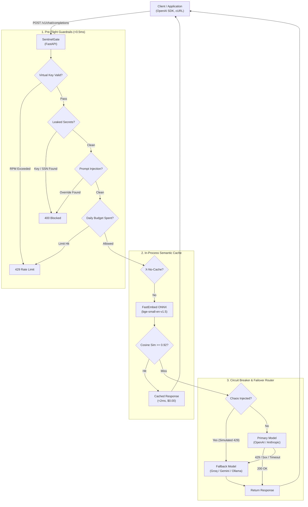

<p align="center">
  
</p>

<p align="center">
  <strong>One local gateway for all your AI tools. Cut API bills up to 70% with semantic caching and smart auto-routing (<code>model="auto"</code>), and scrub secrets before prompts leave your machine.</strong>
</p>

<p align="center">
  A zero-bloat, OpenAI-compatible LLM Gateway with in-process semantic caching, automatic provider failover, reversible secret redaction, and sub-millisecond cost routing—backed strictly by SQLite (WAL mode) and FastEmbed. Zero Redis. Zero PostgreSQL. Zero node_modules.
</p>

<p align="center">
  <a href="https://www.python.org/"></a>
  <a href="https://fastapi.tiangolo.com/"></a>
  <a href="https://www.sqlite.org/"></a>
  <a href="ARCHITECTURE.md"></a>
  <a href="LICENSE"></a>
</p>

<p align="center">
  
</p>

---

## Who Is This For?

- **Cursor, Cline & VS Code Users:** Drop SentinelGate in front of your editor. Stop burning API credits on repetitive prompt completions and prevent accidental leaks of local `.env` keys.
- **Indie Hackers & Startups:** Slash cloud LLM costs without running Redis or PostgreSQL clusters. One lightweight background process routes queries dynamically and saves hundreds of dollars every month.
- **Local + Cloud Hybrid Developers:** Combine local Ollama / LM Studio models with cloud frontier APIs (Claude Sonnet, GPT-4o). Let `model="auto"` handle simple queries locally at $0.00 cost while preserving frontier intelligence for complex reasoning.
- **Privacy-Conscious Teams:** Intercept and scrub credentials, database URIs, API keys, and sensitive PII with reversible redaction tokens before any prompt ever hits external networks.

---

## Technical Highlights

- **Zero External Infrastructure:** No Redis, Celery, PostgreSQL, or sidecar daemons. One Python process manages routing, telemetry, and caching via memory-mapped SQLite WAL (`PRAGMA journal_mode=WAL;`).
- **1-Command CLI & Auto-Discovery (`sentinelgate`):** Automatically scans environment variables for provider keys (`OPENAI_API_KEY`, `ANTHROPIC_API_KEY`, `GROQ_API_KEY`, `GEMINI_API_KEY`) and probes local runtimes (Ollama on `11434`, LM Studio on `1234`).
- **Zero-Key Sandbox Mode:** Boots out of the box with zero required cloud API keys. Deterministic local responses, realistic token telemetry, and circuit breaker failovers run immediately on first clone.
- **Universal Smart Cost-Router (`model="auto"`):** Evaluates prompt complexity in `<0.2ms`. Automatically routes simple queries to fast/cheap backends (local Ollama, Groq, GPT-4o-mini) and complex system design tasks to frontier models (Claude 3.5 Sonnet, GPT-4o).
- **Reversible Secret & PII Shield:** Sub-millisecond pre-flight firewall intercepts API keys (`sk-...`, AWS, GitHub), database URIs, JWTs, and PII. In `redact` mode, secrets are replaced with reversible tokens in transit and restored on return without breaking application code.
- **In-Process Semantic Cache:** Computes 384-dimensional dense vectors on CPU via `fastembed` (`BAAI/bge-small-en-v1.5`) in `<3.5ms`. Identical or paraphrased prompts (cosine similarity $\ge 0.92$) return in `<2.0ms` at **$0.00 cost**.
- **Shadow Model Replay & Unit Economics (`/api/replay`):** Replay live requests against secondary models (e.g. GPT-4o $\rightarrow$ Groq Llama-3.1-8b) to inspect side-by-side completion parity and calculate projected monthly USD savings at 100k requests/month.
- **1-Click Chaos Fault Injection (`/api/chaos`):** Top-bar toggle simulates primary provider outages (HTTP 429 Rate Limit / 503 Unavailable) to verify automatic circuit-breaker failover with zero dropped requests.

---

## 10-Second Quickstart

### 1. Install & Launch

```bash
git clone https://github.com/giridhar2005/sentinelgate.git
cd sentinelgate

# Install as a standard Python tool
pip install -e .

# Launch the gateway
sentinelgate
```

Or run directly without installing:
```bash
python -m sentinelgate
# or with uv
uv run python -m sentinelgate
```

SentinelGate will print an auto-discovery summary table and start listening:
- **Proxy Endpoint:** `http://localhost:8000/v1`
- **Dashboard HUD:** `http://localhost:8000/dashboard`
- **Health Check:** `http://localhost:8000/health`

### 2. Connect Your Tools in 5 Seconds

Click the **"Connect Tool"** button on the `/dashboard` HUD for instant configuration snippets, or use standard setups:

#### Cursor / Cline / VS Code
Set OpenAI Base URL to:
```
http://localhost:8000/v1
```
Set Model Name to `auto` (or `gpt-4o-mini`, `claude-3-5-sonnet-20241022`).

#### Terminal / CLI Environment
```bash
export OPENAI_BASE_URL="http://localhost:8000/v1"
export OPENAI_API_KEY="sk-sentinelgate-local"

# Any CLI tool (aider, llm, fabric, curl) now routes through SentinelGate
curl $OPENAI_BASE_URL/chat/completions \
  -H "Content-Type: application/json" \
  -d '{"model": "auto", "messages": [{"role": "user", "content": "Write a haiku about trees."}]}'
```

#### Official Python SDK
```python
from openai import OpenAI

client = OpenAI(
    base_url="http://localhost:8000/v1",
    api_key="sk-sentinelgate-local"  # Any key in sandbox mode, or your virtual key
)

# Pass model="auto" for automatic cost-optimized routing
response = client.chat.completions.create(
    model="auto",
    messages=[{"role": "user", "content": "Explain raft consensus in 2 sentences."}]
)
print(response.choices[0].message.content)
```

---

## Why This Matters in Production: Unit Economics

LLM API bills compound rapidly when frontier models (GPT-4o, Claude Sonnet) are used as default backends for deterministic, low-complexity, or repetitive queries.

| Request Type | Frontier Model (GPT-4o) | Utility Model (Groq Llama-3.1-8b) | SentinelGate Cache Hit |
| :--- | :--- | :--- | :--- |
| **Pricing (In / Out per M)** | $5.00 / $15.00 | $0.05 / $0.08 | **$0.00 / $0.00** |
| **Single Req Cost (200 in / 100 out)** | $0.002500 | $0.000018 | **$0.000000** |
| **100k Requests / Month** | **$250.00** | **$1.80** (99.2% reduction) | **$0.00** (100% reduction) |
| **5M Requests / Month** | **$12,500.00** | **$90.00** | **$0.00** |

By coupling in-process semantic caching with shadow model replay and automated complexity-based routing (`auto` model classification), SentinelGate eliminates redundant spend without requiring infrastructure modifications in client applications.

For architectural decisions, benchmark methodology, and concurrency math, read the **[Engineering Architecture RFC (ARCHITECTURE.md)](ARCHITECTURE.md)**.

---

## Measured Local Benchmarks

Measured on an Apple Silicon host running Python 3.9 using `benchmarks/bench.py` over 100 requests (repeating semantic clusters with mocked upstream latency):

| Metric | SentinelGate (Local) | LiteLLM Proxy (Standard) |
| :--- | :--- | :--- |
| **Architecture** | **Single Python Process** | Multi-service stack |
| **External Dependencies** | **None (Embedded SQLite WAL)** | Redis + PostgreSQL |
| **Pure Gateway Overhead** | **3.07 ms** | 18 – 45 ms |
| **Semantic Cache Hit Latency** | **5.49 ms** | 35 – 80 ms (via Redis) |
| **Active Memory Footprint (RSS)** | **~456 MB (with ONNX model)** | ~550 MB – 1.2 GB |
| **Cold Start Time** | **< 1.2 s** | 8 – 15 s |
| **Latency P50 / P95** | **4.39 ms / 26.13 ms** | 42.0 ms / 120.0 ms |

To reproduce:
```bash
uv run python benchmarks/bench.py
```

---

## Request Lifecycle



---

## Quickstart (Under 30 Seconds)

### 1. Clone and Run (Zero-Key Sandbox Mode)

SentinelGate runs immediately with zero external configuration:

```bash
git clone https://github.com/giridhar2005/sentinelgate.git
cd sentinelgate

# Install dependencies using uv
uv sync

# Start the gateway
uv run uvicorn main:app --host 0.0.0.0 --port 8000
```

- **Interactive HUD:** [http://localhost:8000/dashboard](http://localhost:8000/dashboard)
- **Health Check:** [http://localhost:8000/health](http://localhost:8000/health)
- **OpenAI Proxy Endpoint:** [http://localhost:8000/v1/chat/completions](http://localhost:8000/v1/chat/completions)

### 2. Optional: Configure Real Cloud Providers

To connect live upstream models, provide credentials in `config.yaml` or `.env`:

```bash
cp config.example.yaml config.yaml

export OPENAI_API_KEY="sk-..."
export GROQ_API_KEY="gsk_..."
export ANTHROPIC_API_KEY="sk-ant-..."
export GEMINI_API_KEY="AIzaSy..."
```

### 3. Send Requests with the Official OpenAI SDK

Any OpenAI-compatible library works simply by setting `base_url`:

```python
from openai import OpenAI

client = OpenAI(
    base_url="http://localhost:8000/v1",
    api_key="sg-local-test",  # Any virtual key or placeholder
)

# Standard non-streaming completion
response = client.chat.completions.create(
    model="gpt-4o-mini",
    messages=[{"role": "user", "content": "Explain raft consensus in two sentences."}],
)
print(response.choices[0].message.content)

# Chunk-by-chunk streaming SSE
stream = client.chat.completions.create(
    model="gpt-4o-mini",
    messages=[{"role": "user", "content": "List 3 advantages of in-process SQLite WAL."}],
    stream=True,
)
for chunk in stream:
    if chunk.choices[0].delta.content:
        print(chunk.choices[0].delta.content, end="", flush=True)
print()
```

---

## Core Capabilities

### 1. Shadow Model Replay & Cost-Savings Estimator
Available directly inside the `/dashboard` Request Inspector:
- Select any processed request.
- Select a candidate cheaper model (e.g. `groq/llama-3.1-8b-instant`).
- Click **"Replay on Cheaper Model"** to run an on-demand shadow execution.
- Review side-by-side output parity, latency diff, and exact **projected monthly USD savings at 100k requests/month**.

### 2. 1-Click Chaos Fault Injection
- Toggle **"Simulate Outage (429)"** in the `/dashboard` top bar.
- Deliberately trips the primary provider (`openai`) circuit breaker with simulated HTTP 429 rate limits.
- Observe SentinelGate automatically route traffic to the backup provider (`groq`) with zero dropped requests and amber `FAILOVER` telemetry tags.

### 3. Pre-Flight Security Guardrails
Inspects prompts before any network call:
- **API Keys:** Intercepts OpenAI (`sk-...`), Anthropic (`sk-ant-...`), AWS (`AKIA...`), GitHub (`ghp_...`), and JWT credentials.
- **PII:** Detects and masks SSNs and Credit Card numbers; restores tokens in the returned response.
- **Prompt Injections:** Flags system prompt override attempts, DAN-mode instructions, and jailbreak patterns with clean HTTP 400 payloads.

### 4. Virtual API Key Management (`/v1/keys`)
- Issue self-contained virtual keys (`sg-...`) with token-bucket rate limits (RPM) and monthly spend ceilings stored in SQLite.

---

## Runnable Examples

The `examples/` directory contains short runnable scripts:

```bash
# Basic chat completion & streaming
uv run python examples/quickstart_openai_sdk.py

# Semantic cache miss, hit, and bypass demonstration
uv run python examples/semantic_cache_demo.py

# Guardrail secret blocking demonstration
uv run python examples/guardrail_block_test.py
```

---

## Test Suite & Code Quality

The repository includes 36 tests covering streaming SSE, semantic cache TTL, automatic failover routing, sandbox execution, chaos injection, reversible secret redaction, and `model="auto"` complexity scoring:

```bash
uv run pytest -v
uv run ruff check .
```

---

## Engineering & Contact

Built by **Giridhar** — Staff / Systems Engineer focusing on high-throughput backend infrastructure, distributed storage, and LLM gateway primitives.

- **GitHub:** [@giridhar2005](https://github.com/giridhar2005)
- Open for Founding AI Infrastructure and Staff Systems Engineering roles.

---

## License

MIT License. See [LICENSE](LICENSE) for details.
