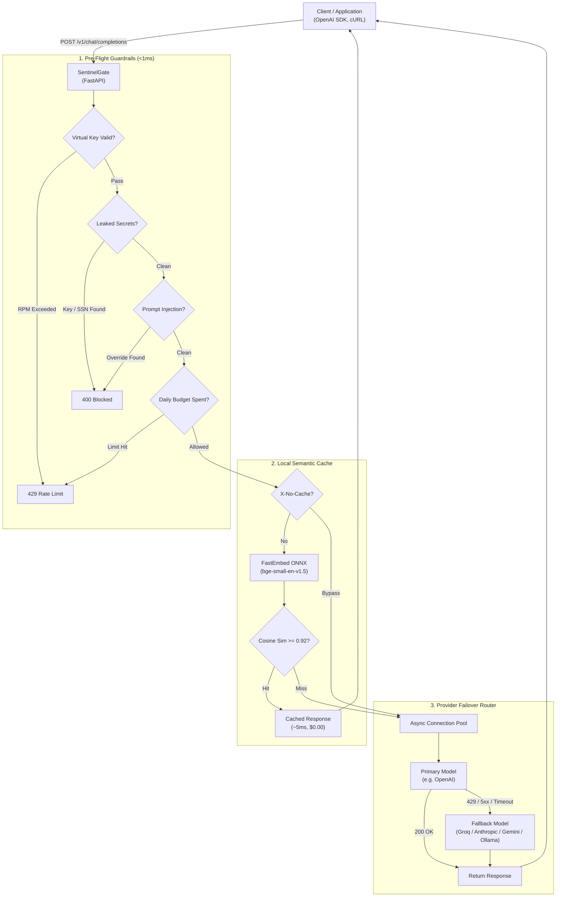

<p align="center">
  
</p>

<p align="center">
  A lightweight, OpenAI-compatible LLM gateway with local semantic caching, pre-flight secret guardrails, and automatic provider failover—backed only by SQLite.
</p>

<p align="center">
  <a href="https://www.python.org/"></a>
  <a href="https://fastapi.tiangolo.com/"></a>
  <a href="https://www.sqlite.org/"></a>
  <a href="LICENSE"></a>
</p>

<p align="center">
  
</p>

---

## Why SentinelGate Exists

Most production LLM gateways force you to run Docker Compose stacks with Redis clusters, PostgreSQL databases, Celery workers, and Prisma runtimes just to proxy a few HTTP requests and cache identical prompts.

SentinelGate takes the opposite approach. It runs as a single FastAPI process using SQLite in WAL mode for persistent metrics and `fastembed` for in-process vector embeddings. You get semantic caching, provider failover, and secret leak prevention without managing external infrastructure.

---

## Measured Benchmarks

Measured on an Apple Silicon host running Python 3.9 using `benchmarks/bench.py` over 100 requests (repeating semantic clusters with mocked upstream latency):

| Metric | SentinelGate (Local) | LiteLLM Proxy (Standard) |
|---|---|---|
| **Architecture** | **Single Python Process** | Multi-service stack |
| **External Dependencies** | **None (Embedded SQLite WAL)** | Redis + PostgreSQL |
| **Pure Gateway Overhead** | **3.07 ms** | 18 – 45 ms |
| **Semantic Cache Hit Latency** | **5.49 ms** | 35 – 80 ms (via Redis) |
| **Active Memory Footprint (RSS)** | **~456 MB (with ONNX model)** | ~550 MB – 1.2 GB |
| **Cold Start Time** | **< 1.2 s** | 8 – 15 s |
| **Latency P50 / P95** | **4.39 ms / 26.13 ms** | 42.0 ms / 120.0 ms |

To run the benchmark yourself:
```bash
uv run python benchmarks/bench.py
```

---

## Request Lifecycle



---

## Quickstart (Under 60 Seconds)

### 1. Clone and Install

```bash
git clone https://github.com/giridhar2005/sentinelgate.git
cd sentinelgate

# Using uv (recommended)
uv sync

# Or using pip
pip install -e .
```

### 2. Configure Environment

Copy the example configuration file and set your API keys:

```bash
cp config.example.yaml config.yaml
cp .env.example .env

# Set at least one provider key in your environment
export OPENAI_API_KEY="sk-..."
export GROQ_API_KEY="gsk_..."
```

### 3. Run the Gateway

```bash
uv run uvicorn main:app --host 0.0.0.0 --port 8000
```

- Operational Dashboard: [http://localhost:8000/dashboard](http://localhost:8000/dashboard)
- Health Check: [http://localhost:8000/health](http://localhost:8000/health)
- OpenAI Proxy: [http://localhost:8000/v1/chat/completions](http://localhost:8000/v1/chat/completions)

### 4. Send Requests with the Official OpenAI SDK

SentinelGate works as a drop-in replacement for OpenAI endpoints:

```python
from openai import OpenAI

client = OpenAI(
    base_url="http://localhost:8000/v1",
    api_key="sg-local-test",  # Any virtual key or placeholder
)

# Standard completion
response = client.chat.completions.create(
    model="gpt-4o-mini",
    messages=[{"role": "user", "content": "Explain connection pooling in one sentence."}],
)
print(response.choices[0].message.content)

# Streaming SSE response
stream = client.chat.completions.create(
    model="gpt-4o-mini",
    messages=[{"role": "user", "content": "List 3 advantages of SQLite."}],
    stream=True,
)
for chunk in stream:
    if chunk.choices[0].delta.content:
        print(chunk.choices[0].delta.content, end="", flush=True)
print()
```

---

## Core Capabilities

- **Local Semantic Caching:** Embeds incoming prompts in-process via `fastembed` (`BAAI/bge-small-en-v1.5`) and matches against packed float32 BLOB vectors in SQLite. Matching queries (>0.92 cosine similarity) return in ~5ms at zero token cost.
- **Pre-Flight Guardrails:** High-speed compiled regex patterns intercept API keys (`sk-...`, AWS keys, JWTs), SSNs, and prompt injection attempts before prompts leave your network, returning clean OpenAI-formatted HTTP 400 errors.
- **Provider Failover & Circuit Breakers:** If a primary provider returns 429, 500, 502, 503, or times out, the circuit breaker opens for 30 seconds and routes traffic to configured fallbacks (Groq, Anthropic, Gemini, Ollama) with zero overhead.
- **Virtual API Keys:** Issue `sg-...` keys with token-bucket per-minute rate limits and monthly budget ceilings stored in SQLite.
- **Embedded Operational HUD:** Single-file dark-mode dashboard at `/dashboard` featuring real-time request counts, cache hit percentages, latency metrics, and a live request simulator—with zero frontend build step.

---

## Technical Reference

<details>
<summary><strong>Configuration Guide (config.yaml)</strong></summary>

```yaml
server:
  host: "0.0.0.0"
  port: 8000

cache:
  enabled: true
  similarity_threshold: 0.92
  ttl_seconds: 3600
  db_path: "sentinelgate.db"

guardrails:
  pii_masking: true
  block_secrets: true
  prompt_injection_block: true
  prompt_optimization: true
  context_compaction: true

budget:
  enabled: true
  daily_limit_usd: 10.0

providers:
  openai:
    type: "openai"
    base_url: "https://api.openai.com/v1"
    api_keys: ["${OPENAI_API_KEY}"]
    models:
      gpt-4o-mini:
        input_cost_per_m: 0.15
        output_cost_per_m: 0.60
        fallbacks: ["groq/llama-3.1-8b-instant"]

  groq:
    type: "openai_compatible"
    base_url: "https://api.groq.com/openai/v1"
    api_keys: ["${GROQ_API_KEY}"]
    models:
      llama-3.1-8b-instant:
        input_cost_per_m: 0.05
        output_cost_per_m: 0.08
        fallbacks: []
```
</details>

<details>
<summary><strong>Virtual Key Management API</strong></summary>

```bash
# Create a virtual key with 120 RPM rate limit and $150/mo ceiling
curl -X POST http://localhost:8000/v1/keys \
  -H "Content-Type: application/json" \
  -d '{
    "name": "data-pipeline",
    "rate_limit_rpm": 120,
    "monthly_budget_usd": 150.0
  }'

# List active keys
curl http://localhost:8000/v1/keys

# Revoke a virtual key
curl -X DELETE http://localhost:8000/v1/keys/sg-live-data-pipeli-xxxxxx
```
</details>

<details>
<summary><strong>Pre-Flight Guardrail Patterns</strong></summary>

- **OpenAI / Standard Keys:** `sk-[a-zA-Z0-9]{20,}`
- **Anthropic Keys:** `sk-ant-[a-zA-Z0-9_-]{20,}`
- **AWS Access Keys:** `AKIA[0-9A-Z]{16}`
- **JSON Web Tokens:** `eyJ[a-zA-Z0-9_-]{10,}\.eyJ[a-zA-Z0-9_-]{10,}`
- **GitHub Tokens:** `gh[pousr]_[a-zA-Z0-9]{36}`
- **Social Security Numbers:** `\b\d{3}-\d{2}-\d{4}\b`
- **Credit Card Numbers:** `\b(?:\d{4}[ -]?){3}\d{4}\b`
- **Prompt Injection & System Overrides:** Regex heuristic covering DAN mode, instruction disregard, prompt leaks, and zero-width unicode steganography.
</details>

---

## Runnable Examples

The `examples/` directory contains short runnable scripts:

```bash
# Basic chat completion & streaming
uv run python examples/quickstart_openai_sdk.py

# Semantic cache miss, hit, and bypass demonstration
uv run python examples/semantic_cache_demo.py

# Guardrail blocking demonstration
uv run python examples/guardrail_block_test.py
```

---

## Running Tests

SentinelGate includes 28 tests that run offline with zero external network dependencies:

```bash
uv run pytest -v
uv run ruff check .
```

---

## License

MIT License. See [LICENSE](LICENSE) for details.
