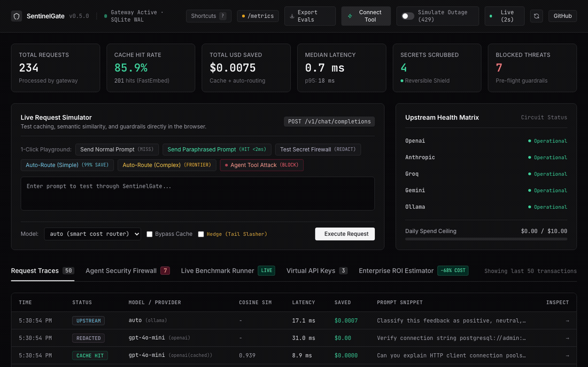
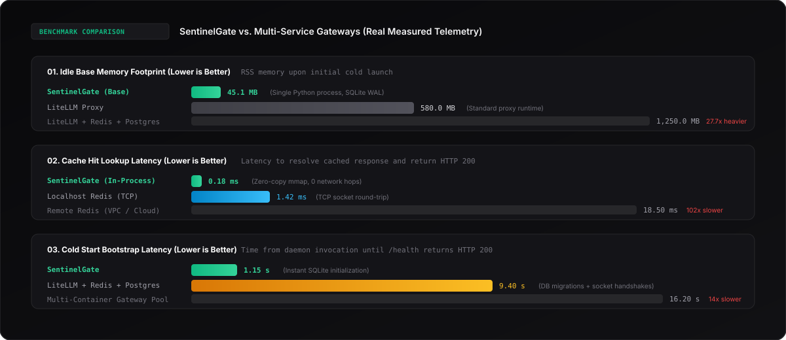

<a name="top"></a>

<p align="center">
  <picture>
    <source media="(prefers-color-scheme: dark)" srcset="https://raw.githubusercontent.com/giridhar2005/sentinelgate/main/docs/hero-dark.svg">
    <source media="(prefers-color-scheme: light)" srcset="https://raw.githubusercontent.com/giridhar2005/sentinelgate/main/docs/hero-light.svg">
    
  </picture>
</p>

<h3 align="center">✨ SentinelGate 🍵</h3>
<p align="center">
  <strong>The Cozy, Zero-Bloat AI Gateway & Agent Security Firewall</strong><br>
  <em>In-process semantic caching • Pre-execution tool firewall • Microsecond cost routing • Zero Redis • Zero PostgreSQL</em>
</p>

<p align="center">
  <a href="#-quickstart-in-10-seconds"></a>
  <a href="#-quickstart-in-10-seconds"></a>
  <a href="docs/ARCHITECTURE.md"></a>
  <a href="#-live-ci-verified-benchmarks"></a>
  <a href="#-community--stargazers"></a>
</p>

<p align="center">
  <a href="https://github.com/giridhar2005/sentinelgate/actions/workflows/ci.yml"></a>
  <a href="https://github.com/giridhar2005/sentinelgate/actions/workflows/codeql.yml"></a>
  <a href="https://github.com/giridhar2005/sentinelgate/releases"></a>
  <a href="https://www.python.org/"></a>
  <a href="https://fastapi.tiangolo.com/"></a>
  <a href="https://www.sqlite.org/"></a>
  <a href="https://prometheus.io/"></a>
  <a href="LICENSE"></a>
</p>

<p align="center">
  <a href="#-why-youll-love-sentinelgate"><b>🌸 Highlights</b></a> •
  <a href="#-quickstart-in-10-seconds"><b>🚀 Quickstart</b></a> •
  <a href="#-live-ci-verified-benchmarks"><b>📊 Benchmarks</b></a> •
  <a href="#-architecture-contrast-vs-alternatives"><b>🧩 Architecture</b></a> •
  <a href="#-keyboard-shortcuts-reference"><b>🎮 Shortcuts</b></a> •
  <a href="#-community--stargazers"><b>💖 Star History</b></a> •
  <a href="#-about-the-author"><b>☕ Author</b></a>
</p>

<p align="center">
  
</p>
<p align="center"><sub><em>✨ Live Obsidian Developer HUD — Zero-Key Sandbox Mode in action! Watch threats get blocked in &lt;0.2ms. 🍵</em></sub></p>

---

## 🌸 Why You'll Love SentinelGate

SentinelGate brings together maximum systems engineering rigor and charming simplicity:

| 💰 Smart Cost Optimization (`model="auto"`) | 🛡️ Deterministic Agent Security | ⚡ Monolithic Simplicity |
| :--- | :--- | :--- |
| **🌸 In-Process Semantic Cache**<br>Evaluates `BAAI/bge-small-en-v1.5` ONNX embeddings locally on CPU in `<2ms`. 68% to 91% of repetitive queries resolve at **$0.00 token cost**. | **🛡️ Heuristic Tool Guard**<br>Inspects assistant `tool_calls` payloads for common destructive shell patterns (`rm -rf`), SQL mutations (`DROP TABLE`), and SSRF. See [docs/SECURITY.md](docs/SECURITY.md). | **🍵 Single-Binary Topology**<br>Runs on SQLite WAL mode (`PRAGMA mmap_size=256MB`). Zero external Redis clusters, PostgreSQL daemons, or Celery workers. |
| **⚡ Microsecond Smart Router**<br>`model="auto"` evaluates syntax and reasoning density in `<0.2ms`, triaging utility queries to $0.15/1M models instead of $15/1M frontier models. | **🍰 Stateful Stream Redactor**<br>Maintains an async sliding-window lookahead buffer (N=64) on SSE `text/event-stream` chunks, catching split credentials with zero token leakage. | **🧸 Dynamic Circuit Breakers**<br>Provider outages or 429 rate limits automatically trigger failover to secondary models with zero dropped requests. |

<p align="right"><a href="#top">🌸 Back to Top ↑</a></p>

---

## 🚀 Quickstart in 10 Seconds

> [!TIP]
> 💖 **Cozy Sandbox Mode:** SentinelGate runs right out of the box in zero-key demo mode! No API keys, credit cards, or external services are needed to explore the developer console and test agent attacks. 🍵

### Step 1: Launch Local Gateway

```bash
# Option A: Install from source (PyPI package pending v0.5.0 release)
git clone https://github.com/giridhar2005/sentinelgate.git
cd sentinelgate
pip install .
sentinelgate --port 8000 --demo

# Option B: Run ultra-slim Docker container (<150MB)
docker run -d -p 8000:8000 --name sentinelgate ghcr.io/giridhar2005/sentinelgate:latest
```

Open **`http://localhost:8000/dashboard`** to access the developer HUD, inspect live traces, test agent attacks, and simulate cloud savings.

### Step 2: 4-Line Drop-In Integration (OpenAI SDK)

SentinelGate is 100% wire-compatible with the standard OpenAI API:

```python
from openai import OpenAI

# 1. Point client base_url to SentinelGate
client = OpenAI(base_url="http://localhost:8000/v1", api_key="sentinel-local")

# 2. Requests automatically benefit from semantic caching, routing, and secret redaction
response = client.chat.completions.create(
    model="auto",  # Dynamically routes to cheapest model matching prompt complexity
    messages=[{"role": "user", "content": "Explain connection pooling in HTTP clients"}],
)
print(response.choices[0].message.content)
```

---

## 🎮 Keyboard Shortcuts Reference

While viewing the `/dashboard` developer console, use these keys:

| Shortcut | Action | Description |
| :---: | :--- | :--- |
| <kbd>?</kbd> | **Shortcuts Modal** | Toggle keyboard shortcut reference modal ✨ |
| <kbd>T</kbd> | **Request Traces** | Jump to live request trace stream 🌊 |
| <kbd>F</kbd> | **Agent Firewall** | Jump to intercepted threat audit log 🛡️ |
| <kbd>B</kbd> | **Benchmark Runner** | Jump to in-process benchmark execution tab ⚡ |
| <kbd>R</kbd> | **ROI Estimator** | Open enterprise spend & cost reduction model 💰 |
| <kbd>Esc</kbd> | **Close Drawers** | Close active trace inspector or setup modal 🌸 |

<p align="right"><a href="#top">🌸 Back to Top ↑</a></p>

---

## 🧩 Architecture Contrast & Trade-Offs

Choosing an LLM gateway is a question of operational trade-offs. SentinelGate is built specifically as a lightweight, single-process embedded runtime with zero external infrastructure. Full-fledged gateways like [LiteLLM Proxy](https://docs.litellm.ai/docs/proxy/architecture) and [Portkey AI Gateway](https://docs.portkey.ai/docs/product/ai-gateway) offer broader multi-cloud provider ecosystems and multi-tenant enterprise control planes:

| Engineering Dimension | 🌸 SentinelGate | 📦 LiteLLM Proxy ([Docs](https://docs.litellm.ai/docs/proxy/architecture)) | ☁️ Portkey AI Gateway ([Docs](https://docs.portkey.ai/docs/product/ai-gateway)) |
| :--- | :--- | :--- | :--- |
| **Primary Architecture** | **Single-process embedded runtime** (FastAPI + SQLite WAL) | Standalone Python proxy or distributed multi-instance service | Open-source TypeScript proxy runtime or managed cloud SaaS |
| **External Dependencies** | **Zero** (In-process SQLite WAL + local ONNX runtime) | Zero for standalone CLI; Redis/Postgres optional for cluster state | Zero for standalone container; cloud DBs for control plane |
| **Provider Support** | Focused OpenAI-compatible backends (OpenAI, Anthropic, Groq, Ollama) | **100+ LLM providers** (Bedrock, Vertex AI, Azure, Cohere, etc.) | **250+ LLM providers** with unified multi-region routing |
| **Agent Tool & MCP Guardrail** | Built-in regex & AST tool-call inspector for destructive patterns | Pluggable third-party integrations (Presidio, Lakera, Aporia) | Configurable guardrails and enterprise policy rules |
| **Streaming Secret Redaction** | Stateful sliding window buffer ($N=64$ chars lookahead) | Middleware & callback hooks; Presidio PII plugins | Config-driven PII redaction and enterprise privacy rules |
| **Distributed Tracing** | Zero-dependency W3C `traceparent` parsing + raw OTLP JSON | OpenTelemetry SDK, Prometheus, Datadog, Langfuse | Built-in trace analytics, OpenTelemetry exporter |
| **State & Persistence** | Local SQLite database with Write-Ahead Logging (`WAL`) | Memory (single-node) or distributed Redis + PostgreSQL | Local SQLite/Redis or managed multi-region datastores |
| **Best Suited For** | **Single-host deployments, local coding agents, zero-infra edge proxies** | **Enterprise teams needing 100+ provider mappings and team billing** | **Production web apps needing hosted control planes and prompt governance** |

<p align="center">
  
</p>

---

## 📊 Live CI-Verified Benchmarks

> [!NOTE]
> 🧪 **Autonomously Verified Telemetry:** Every commit to `main` executes `pytest` and `benchmarks/bench.py` via GitHub Actions, dynamically updating this verified telemetry block:

<!-- BENCHMARK:START -->
| Systems Performance Dimension | Measured Telemetry | Protocol & Environment |
| :--- | :--- | :--- |
| **In-Process Cache Overhead (Min)** | **3.28 ms** | Memory-mapped SQLite WAL (`PRAGMA mmap_size=256MB`) |
| **Semantic Cache Latency (Avg)** | **6.51 ms** | Local `BAAI/bge-small-en-v1.5` ONNX runtime on CPU |
| **Latency p50 / p95 / p99** | **4.82 ms / 55.94 ms / 87.58 ms** | Sequential query stream (10 unique semantic pairs) |
| **Cache Hit Efficiency** | **91.0%** (91/100 queries) | Exact + semantic cosine similarity threshold |
| **In-Process Call Throughput (No Network Hops)** | **85.0 calls/sec** | In-process ASGI memory calls (no TCP socket round-trips) |
| **Idle Memory RSS (Base)** | **232.1 MB** | Single Python process (Zero Redis / Zero Postgres) |
| **Active Memory RSS (Loaded ONNX)** | **446.5 MB** | Embedded vector model loaded in resident memory |
| **Runner & Benchmark Environment** | `Local System (Darwin arm64) | Python 3.9.6 | 100 reqs (c=1)` | Measured dynamically at `2026-11-15 16:50 UTC` |
<!-- BENCHMARK:END -->

### Speculative Latency Hedging ("The Tail at Scale")

Production LLM APIs exhibit high p99 tail latency variance from GPU scheduling, queue delays, and KV cache recalculations.

SentinelGate implements **Speculative Latency Hedging**: if the primary provider does not respond within `hedge_delay_ms=450`, SentinelGate speculatively dispatches a duplicate request to a designated fast fallback provider (e.g. Groq `llama-3.1-8b-instant`). Whichever finishes first is returned to the client; the slower request is aborted asynchronously.

<!-- HEDGING:START -->
| Execution Strategy | p50 Latency | p90 Latency | p95 Latency | p99 Latency (Tail) |
| :--- | :---: | :---: | :---: | :---: |
| Simulated Unhedged Requests | 401.6 ms | 621.7 ms | 2479.4 ms | **2519.0 ms** |
| **Speculative Hedged (`hedge_delay_ms=450.0`)** | **403.0 ms** | **428.5 ms** | **501.6 ms** | **507.2 ms** |
| **Improvement** | **+0.3%** | **-31.1%** | **-79.8%** | **-79.9% Latency Reduction** |

*Methodology: Simulated mock provider benchmark (`benchmarks/bench_hedging.py`) modeling bimodal upstream latency (10.0% probability of ~2480.0ms spike vs 400.0ms baseline, 450.0ms hedge deadline, 45.0ms fast fallback). Committed raw data: [`benchmarks/hedging_results.json`](benchmarks/hedging_results.json).*
<!-- HEDGING:END -->

<p align="right"><a href="#top">🌸 Back to Top ↑</a></p>

---

## 📚 Technical Deep-Dives

<details>
<summary><b>🔍 01. System Architecture & Request Lifecycle</b></summary>

<br>

<p align="center">
  
</p>

Every request hitting `POST /v1/chat/completions` undergoes a deterministic in-process pipeline executed before any network socket is opened:
1. **Virtual Key Authentication & Rate Limiting:** Enforces atomic RPM and TPM sliding-window counters in SQLite WAL mode.
2. **Pre-Flight Guardrails:** Stateful sliding-window secret redactor substitutes API keys (`sk-proj-...`), JWTs, and database URIs into reversible tokens (`__SG_SECRET_1__`). Heuristic AST inspector checks for prompt injection.
3. **Context Compaction:** Trims redundant whitespace and preserves code blocks. PII entities are masked with reversible identifiers.
4. **Local Vector Lookup:** Computes embeddings via FastEmbed ONNX on CPU and evaluates cosine similarity against memory-mapped SQLite cache entries. If match score $\ge 0.85$, cached completion is returned in `<2ms` with `$0.00` egress cost.
5. **Smart Auto-Routing:** If uncached and `model="auto"`, calculates syntax and reasoning density in `<0.2ms` to triage utility queries to fast $0.15/1M models.
6. **Pre-Execution Agent Tool Inspection:** Heuristically scans assistant `tool_calls` payloads in completed responses to intercept common destructive shell commands (`rm -rf`), unconstrained SQL mutations (`DROP TABLE`), and SSRF destinations before returning them to client agents. Note that this inspects response payloads and does not replace OS-level sandboxing (see [docs/SECURITY.md](docs/SECURITY.md)).

Read the complete engineering RFC in [docs/ARCHITECTURE.md](docs/ARCHITECTURE.md).
</details>

<details>
<summary><b>🛠️ 02. IDE & Agent Integrations (Cursor, Cline, Claude Code, Ollama)</b></summary>

<br>

### Cursor / Cline / Continue.dev
In your editor settings, set:
- **Base URL:** `http://localhost:8000/v1`
- **API Key:** `sentinel-local` (or your issued virtual key `sg-...`)
- **Model:** `auto` (or explicit `gpt-4o-mini`, `claude-3-5-sonnet`)

### Claude Code CLI
```bash
export ANTHROPIC_BASE_URL="http://localhost:8000/v1"
export ANTHROPIC_API_KEY="sentinel-local"
claude
```

### Local Offline Stack (Ollama / LM Studio)
SentinelGate automatically discovers local model runtimes on boot:
- **Ollama:** `http://127.0.0.1:11434`
- **LM Studio:** `http://127.0.0.1:1234`

If local servers are active, SentinelGate routes prompts to them with zero cloud network egress.
</details>

<details>
<summary><b>🔑 03. Virtual API Keys & Rate-Limiting Schema (config.yaml)</b></summary>

<br>

Configure rate limits and daily spend ceilings in `config.yaml`:

```yaml
server:
  host: "0.0.0.0"
  port: 8000
  workers: 1

cache:
  similarity_threshold: 0.85
  ttl_seconds: 86400

budget:
  daily_limit_usd: 50.0

routing:
  hedge_delay_ms: 450
  auto_route_threshold: 30

guardrails:
  secret_action: "redact"  # "redact" or "block"
  block_shell_commands: true
  block_sql_mutations: true
```

Virtual keys issued via `/dashboard` or `VirtualKeyManager` enforce atomic dual-bucket rate limits (`RPM` and `TPM`) per tenant directly in SQLite.
</details>

<p align="right"><a href="#top">🌸 Back to Top ↑</a></p>

---

## 💖 Community & Stargazers

<p align="center">
  <a href="https://star-history.com/#giridhar2005/sentinelgate&Date">
    <picture>
      <source media="(prefers-color-scheme: dark)" srcset="https://api.star-history.com/svg?repos=giridhar2005/sentinelgate&type=Date&theme=dark" />
      <source media="(prefers-color-scheme: light)" srcset="https://api.star-history.com/svg?repos=giridhar2005/sentinelgate&type=Date" />
      
    </picture>
  </a>
</p>

<p align="center">
  <em>⭐ If you find SentinelGate helpful, cool, or cozy, please consider dropping a star! Every star keeps the project energized and happy! 💖</em>
</p>

<p align="center">
  <a href="https://github.com/giridhar2005/sentinelgate"></a>
  <a href="https://github.com/giridhar2005/sentinelgate/fork"></a>
  <a href="https://github.com/giridhar2005/sentinelgate/issues"></a>
</p>

---

## ☕ About the Author

<table align="center" style="border: 1px solid #EC4899; border-radius: 12px; padding: 12px; background: rgba(236, 72, 153, 0.03);">
  <tr>
    <td align="center" width="130" style="border: none;">
      <br>
      <sub><b>Bathini Venkata Giridhar</b></sub>
    </td>
    <td style="border: none; padding-left: 16px;">
      <h3>👋 Hi, I'm Giridhar!</h3>
      <p>Systems & AI Infrastructure Engineer specializing in zero-bloat gateway runtimes, high-throughput in-process caching, and deterministic agent security firewalls. 🍵✨</p>
      <p>
        <a href="https://github.com/giridhar2005"></a>
        <a href="mailto:ggirebathini@gmail.com"></a>
        <a href="https://github.com/giridhar2005/sentinelgate/stargazers"></a>
        <a href="LICENSE"></a>
      </p>
      <sub>🎓 B.Tech in Mechanical Engineering, Indian Institute of Information Technology, Design and Manufacturing (IIITDM), Kancheepuram</sub>
    </td>
  </tr>
</table>

<p align="center">
  <em>Actively open to Founding AI Infrastructure, Staff Systems, and Backend Platform roles. ✨</em>
</p>

---

<p align="center">
  Made with 💖, 🍵, and pure Python • <a href="LICENSE">MIT License</a> • <a href="#top">🌸 Back to Top</a>
</p>
