# Bathini Venkata Giridhar

  <strong>Systems &amp; AI Infrastructure Engineer</strong> specializing in high-throughput gateway runtimes, in-process storage engines, and agentic security firewalls.

  🎓 <strong>B.Tech in Mechanical Engineering</strong>, IIITDM Kancheepuram 
  🏛️ <strong>Incoming Economics &amp; Business Administration</strong>, University of St. Gallen (HSG) 
  📫 <strong>Email:</strong> <a href="mailto:ggirebathini@gmail.com">ggirebathini@gmail.com</a> &bull; 
  🌐 <strong>GitHub:</strong> <a href="https://github.com/giridhar2005">github.com/giridhar2005</a>

  
  
  

---

## ⭐️ Flagship Open-Source Project

### [SentinelGate](https://github.com/giridhar2005/sentinelgate) &mdash; Zero-Bloat, OpenAI-Compatible LLM Gateway

> *A single-binary Python gateway backed by in-process SQLite WAL mode, FastEmbed ONNX vector embeddings, pre-execution agent tool firewalls, and stateful sliding-window secret redaction. Zero Redis. Zero PostgreSQL. Zero node_modules.*

  <a href="https://github.com/giridhar2005/sentinelgate">
    <picture>
      <source media="(prefers-color-scheme: dark)" srcset="https://raw.githubusercontent.com/giridhar2005/sentinelgate/main/docs/hero-dark.svg">
      <source media="(prefers-color-scheme: light)" srcset="https://raw.githubusercontent.com/giridhar2005/sentinelgate/main/docs/hero-light.svg">
      
    </picture>
  </a>

  
  
  
  

### Key Systems Engineering Highlights:
- **0.18 ms Cache Lookup Overhead:** Evaluates vector embeddings (`BAAI/bge-small-en-v1.5`) via FastEmbed ONNX on CPU; stores vectors in memory-mapped SQLite WAL (`PRAGMA mmap_size=256MB`).
- **Pre-Execution Agent Tool Firewall:** Deterministically parses assistant `tool_calls` in `<0.2ms` to halt destructive shell (`rm -rf`), SQL (`DROP TABLE`), and SSRF operations before client execution.
- **Stateful Sliding-Window Stream Redaction:** Uses an async N=64 char lookahead buffer on SSE streams to catch split credentials with zero token leakage.
- **14,200 req/sec Peak Single-Core Throughput:** Single Python process consuming only 45 MB idle RAM (vs 1.2GB for multi-container Redis+Postgres stacks).

---

## 🛠️ Systems & Technical Core

| Domain | Technologies & Systems Primitives |
| :--- | :--- |
| **AI Infrastructure** | LLM Gateways, Semantic Vector Caching, Speculative Latency Hedging, FastEmbed ONNX, Agent Firewalls, Model Routing |
| **High-Throughput Backend** | Python 3.11+, FastAPI, `asyncio`, async `httpx` connection pooling, Pydantic v2, Ruff |
| **Embedded Storage Engines** | SQLite in WAL mode, memory-mapped I/O (`PRAGMA mmap_size`), zero-dependency ACID logging |
| **Observability & Protocols** | W3C `traceparent` propagation, OTLP JSON exporters, Prometheus RFC 0004 exposition, non-blocking telemetry queues |
| **Testing & Verification** | Adversarial security suites, sliding-window stream chunking tests, multi-worker concurrency load tests (`pytest`, `locust`) |

---

## 💼 What I Am Looking For

I am actively open to **Founding AI Infrastructure Engineer**, **Senior/Staff Backend Systems Engineer**, and **Platform Engineering** roles at early-stage AI startups and high-scale infrastructure teams.

Feel free to connect directly via [GitHub](https://github.com/giridhar2005) or email at **[ggirebathini@gmail.com](mailto:ggirebathini@gmail.com)**.
